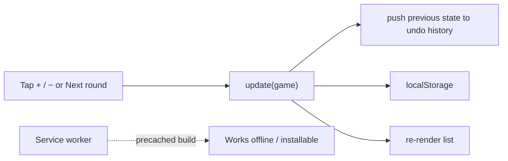

# boardgame-counter

A phone-first PWA for keeping score in board games, round by round. Add players, tap `+`/`−`
by a step of 1, 5 or 10 to score the current round, then *Next round*. A table
shows every round, the cards show running totals. Undo works across rounds.
The look follows the [thurbox](https://github.com/Thurbeen/thurbox) website.
Everything stays on the device (`localStorage`) and works offline once loaded.



## Install on a phone

Open the deployed site, then *Add to Home screen* (Android Chrome) or
*Share → Add to Home Screen* (iOS Safari).

## Develop

```sh
npm install
npm run dev        # dev server
npm run build      # typecheck + production build into dist/
npm run test:e2e   # Playwright against the production build, Pixel 7 viewport
```

First run of the tests needs a browser: `npx playwright install chromium`, or
point `PW_CHROMIUM` at an existing Chromium binary.

Pre-commit hooks run with [prek](https://github.com/j178/prek): `prek install`.

## Deploy

CI runs the typecheck and e2e tests on every PR. Pushes to `main` also deploy
`dist/` to GitHub Pages — enable it once under *Settings → Pages → Source:
GitHub Actions*.
