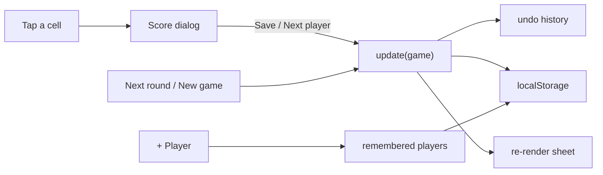

# boardgame-counter

A phone-first PWA for keeping score in board games, round by round, styled
after the [thurbox](https://github.com/Thurbeen/thurbox) website.

- The score sheet is a table: a column per player, a row per round, totals
  pinned at the bottom with the leader lit up.
- Tap any cell to score it in a dialog: type a value or use ±1/5/10, then
  *Save*, or *Next player ›* to fill the whole round in one go.
- Players are remembered across games: *+ Player* offers them in one tap.
  Tap a name to rename or remove it.
- *Undo* reverts anything, including *New game*, so nothing asks for confirmation.
- Everything stays on the device (`localStorage`) and works offline once loaded.



## Install on a phone

Open <https://letur.github.io/boardgame-counter/>, then *Add to Home screen* (Android Chrome) or
*Share → Add to Home Screen* (iOS Safari).

## Develop

```sh
npm install
npm run dev        # dev server
npm run build      # typecheck + production build into dist/
npm run test:e2e   # Playwright against the production build, Pixel 7 viewport
```

First run of the tests needs a browser: `npx playwright install chromium`, or
point `PW_CHROMIUM` at an existing Chromium binary.

Pre-commit hooks run with [prek](https://github.com/j178/prek): `prek install`.

## Deploy

CI runs the typecheck and e2e tests on every PR. Pushes to `main` also deploy
`dist/` to GitHub Pages — enable it once under *Settings → Pages → Source:
GitHub Actions*.
